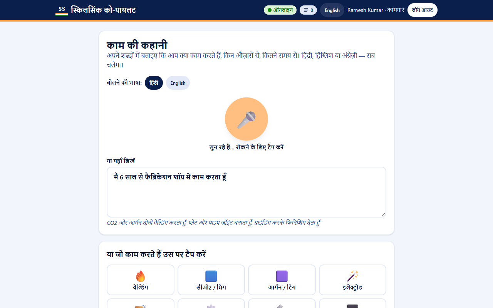
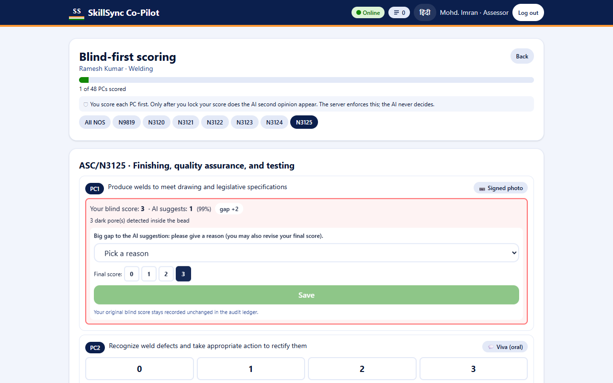
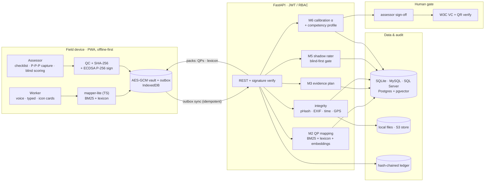

# SkillSync Co-Pilot

> *We don't replace the assessor. We help every assessor score like the best one, and make every certificate audit-proof, even offline in a village workshop.*

AI-assisted, assessor-calibrated, offline-first **Recognition of Prior Learning (RPL)** assessment.
Smart India Hackathon 2026 · Problem Statement **26242** · Ministry of Skill Development & Entrepreneurship.
Demo trade: **Welding** (official NQR QP `QG-4.5-AU-01811-2024-V1-ASDC`), plus 10 drafted QPs for mapping.

[](https://github.com/Aribhussain/skillsync-copilot/actions/workflows/ci.yml)

| Worker: voice declaration (Hindi) | Assessor: blind-first scoring |
|---|---|
|  |  |

More screenshots, desktop and phone: [docs/screenshots/](docs/screenshots/).

## What the problem statement asks → where it lives

| PS 26242 asks for | Module | Where in the code |
|---|---|---|
| Structured self-declaration, auto-mapped to the closest NSQF QP(s) | **M1** voice / typed / icon-card "Kaam ki Kahani" (Hindi, Hinglish, English) · **M2** hybrid QP mapping with top-3, confidence and per-PC claim prefill | [DeclareView.vue](frontend/src/views/worker/DeclareView.vue), [speech.ts](frontend/src/lib/speech.ts), [mapping.py](backend/app/services/mapping.py), [lexicon (399 entries)](data/lexicon/), on-device [mapper-lite](frontend/src/lib/mapper/) |
| Practical evaluation with guided checklists and image aids | **M3** PC-level evidence plan (critical PCs locked to live observation) · **M4** signed Process–Product–Person capture with a challenge code · **M5** blind-first AI shadow rater | [evidence_plan.py](backend/app/services/evidence_plan.py), [CaptureView.vue](frontend/src/views/assessor/CaptureView.vue), [imageQc.ts](frontend/src/lib/imageQc.ts), [deviceKey.ts](frontend/src/lib/deviceKey.ts), [integrity.py](backend/app/services/integrity.py), [shadow_rater.py](backend/app/ml/shadow_rater.py), [scoring.py](backend/app/api/scoring.py) |
| Standardised rubrics across assessors and locations | Rubric anchors on every PC · **M6** hidden golden packets, Krippendorff's α, a private Calibration Index, drift heat-maps | [rubric.py](backend/app/services/rubric.py), [RubricAnchors.vue](frontend/src/components/RubricAnchors.vue), [calibration.py](backend/app/services/calibration.py), [krippendorff.py](backend/app/services/krippendorff.py), [QaHome.vue](frontend/src/views/QaHome.vue) |
| NSQF competency profile + recommendation **for assessor sign-off** | Per-PC profile, Full / Partial / Gap recommendation, bridge modules; sign-off with password re-entry → W3C Verifiable Credential + QR verify page | [profile.py](backend/app/services/profile.py), [credentials.py](backend/app/api/credentials.py), [credential.py](backend/app/services/credential.py), [VerifyView.vue](frontend/src/views/VerifyView.vue) |
| Works in low connectivity | Installable PWA, service worker, encrypted on-device vault, outbox with idempotent sync, resumable chunked uploads | [sw.ts](frontend/src/sw.ts), [sync.ts](frontend/src/lib/sync.ts), [db.ts](frontend/src/lib/db.ts), [vault.ts](frontend/src/lib/vault.ts), [evidence.ts](frontend/src/lib/evidence.ts) |
| Evidence of consistency improvement | Simulated AB/BA crossover study, plus a **live study mode** in the app (assistance OFF, then ON) | [simulate_study.py](scripts/simulate_study.py), [studies.py](backend/app/api/studies.py), [results](docs/results/consistency_study.md) |
| Where the tool supports vs replaces judgement | The table below, enforced in the API rather than the UI | [scoring.py](backend/app/api/scoring.py) (blind-first), [credentials.py](backend/app/api/credentials.py) (human-only sign-off) |

Every important write lands in a hash-chained audit ledger ([audit.py](backend/app/services/audit.py), `GET /audit/verify`) and a DPDP-style consent ledger ([consent.py](backend/app/services/consent.py)).

## Architecture



The full five-layer diagram and the key flows are in [docs/ARCHITECTURE.md](docs/ARCHITECTURE.md).

## Quick start

**Lite mode** needs Python 3.11 and Node 20.19+ (or 22.12+). No Docker and no database server: it uses SQLite and local files.

```bash
git clone https://github.com/Aribhussain/skillsync-copilot && cd skillsync-copilot
npm run setup     # backend venv + deps, frontend deps, .env from .env.example
npm run lite      # API http://localhost:8000/docs  ·  PWA http://localhost:5173
```

On Windows, clone to a short path (for example `C:\dev\skillsync`): a few Python packages nest deeply and can exceed the 260-character path limit.

Optional: run `npm run seed` for a populated demo (6 SYNTHETIC workers, assessments in every state, golden packets, a signed credential). `worker1` is left untouched for the live demo. On macOS / Linux, `make setup`, `make lite-up` and `make seed` do the same.

The optional multilingual embedding re-rank (about 1 GB, with torch) installs with `backend/.venv/Scripts/pip install -r backend/requirements-embeddings.txt`. Without it, BM25 + lexicon does the mapping.

**Full mode** (Docker): Postgres 16 + pgvector, SeaweedFS (S3), Valkey, a Celery worker, and nginx serving the PWA.

```bash
docker compose up -d --build --wait        # app http://localhost:8080 · API http://localhost:8000
backend/.venv/Scripts/python scripts/smoke_full.py   # end-to-end checks against the stack
docker compose down -v
```

**MySQL 8 / SQL Server:** `python scripts/setup_db.py mysql --admin-user root` creates the database and app user, runs the migrations and prints the `DATABASE_URL` for `.env`. The password is asked for at runtime and never stored. This path is compile-tested only; see [Limitations](#honest-limitations).

## Demo accounts

These are local demo defaults, shown on the login screen.

| User | Role | Password |
|---|---|---|
| `worker1` (Ramesh Kumar), `worker2` (Salma Khatoon) | Worker | `worker123` |
| `assessor1`, `assessor2`, `assessor3` | Assessor | `assessor123` |
| `qa1` (Dr. Kavita Rao) | QA lead | `qa123` |
| `admin` | Admin | `admin123` |
| `worker3`…`worker8` (after `npm run seed`) | SYNTHETIC workers | `worker123` |

## 5-minute demo for judges

The full script, with what to say at each step, is in [docs/DEMO_SCRIPT.md](docs/DEMO_SCRIPT.md).

1. **worker1** → consent → speak or type the Hindi/Hinglish story → **Welding is #1** with confidence, matched terms and pre-ticked PCs → confirm.
2. **assessor1** (or assessor2/3: assignment picks the least-loaded) → the PC checklist, with critical PCs locked to live observation.
3. Turn the **network off** → guided Process → Product → Person capture with the one-time challenge code → the shots are signed and queued.
4. Score PCs **blind**; the AI opinion appears only after each lock. A big gap forces a reason code.
5. Network **on** → the outbox syncs and the server verifies every signature.
6. Upload the same photo for **worker2** → it is **flagged as reused**.
7. Competency profile → **Partial** (GTAW gap → bridge module) → **sign off** with a password → a credential is issued → scan the QR → the **verify page shows a valid signature**.
8. **qa1** → calibration dashboard: α, the assessor × NOS drift heat-map, and the audit chain verified.

## Where the tool supports vs replaces judgement

| Decision | AI's role | Final say |
|---|---|---|
| QP suggestion | Ranks the top 3 with confidence and matched terms | Worker + assessor confirm |
| Evidence plan | Rules engine; critical PCs locked to live observation | System rule |
| Evidence authenticity | Flags reuse, EXIF, time and GPS anomalies (flags only) | Assessor reviews |
| PC scores | Second opinion, revealed **only after** the blind score (server-enforced) | Assessor |
| Full / Partial / Gap | Recommends only | Assessor, with password re-entry and a justification when overriding |
| Certificate | None | Awarding body (the credential carries the assessor's decision) |

## Results

| What | Result | Label |
|---|---|---|
| QP mapping, 30 held-out hand-written narratives (short, misspelled, cross-trade traps) | **Top-3 93.3%** (BM25 + lexicon), **96.7%** (+ embeddings); top-1 90.0% | Hard set written before tuning. The narratives are not real worker data. [Details](docs/results/mapping_accuracy.md) |
| QP mapping, 60 template narratives | 100% top-3 | Sanity check only: the templates and lexicon share authors |
| Consistency, AB/BA crossover, 200 Monte-Carlo runs | Krippendorff's α **0.33 → 0.57**; pass/fail α 0.34 → 0.63; pass/fail flip rate 57% → 31% | **SIMULATED.** The gain follows from the stated assumptions, mostly from the rubric anchors; the AI reveal changed about 5% of scores. [Details](docs/results/consistency_study.md) |
| Consistency with real assessors | Live study mode is built (OFF → ON arms, α on the QA dashboard) | **Not yet run with real assessors** |
| Shadow rater (weld defect / quality level) | 95% defect, 90% level accuracy on hold-out and on a fresh seed | **SYNTHETIC images only.** A demo model, not for certification. [Details](docs/results/shadow_rater.md) |

## Tests and CI

GitHub Actions ([ci.yml](.github/workflows/ci.yml)) runs:
- ruff + 141 backend tests;
- eslint, vue-tsc, 119 unit tests and a production build;
- 17 Playwright e2e tests against the dev servers, plus an offline test against the built PWA with its real service worker;
- a Docker full-mode job that runs the compose stack and the smoke test.

Locally, Playwright drives an installed Chromium-based browser (`PLAYWRIGHT_BROWSER_PATH`) with a fresh profile and never downloads browsers.

```bash
npm test                              # backend + frontend unit tests and lint
cd frontend && npx playwright test    # e2e (starts the API and Vite itself)
npm run e2e:pwa --prefix frontend     # offline e2e against the built PWA
npm run screenshots --prefix frontend # regenerates docs/screenshots/
```

## Honest limitations

- **The shadow rater and the golden-packet consensus are synthetic.** They show that the pipeline works, not how a model would do on real welds.
- **The consistency gain is simulated.** Real evidence needs the live study mode with real assessors.
- **Voice input depends on the browser.** It uses the browser's Web Speech API; Chrome on Android supports `hi-IN`, while Brave and Firefox usually don't, and typed text and icon cards are always available. The Bhashini adapter is a scaffold (HTTP 501), and offline speech (Vosk) is not built. Screenshot 1 uses a simulated recogniser so the voice UI can be shown in a headless browser.
- **MySQL / SQL Server have not been run live.** The migrations are compile-tested for both dialects, and `setup_db.py` is unit-tested.
- **The Docker image omits torch**, so full mode maps with BM25 + lexicon. pgvector is wired in and smoke-tested, but holds the embeddings only when they are enabled.
- **The VC has not been checked with an external verifier.** The proof follows `eddsa-jcs-2022` with a `did:key` issuer. The SIDH export is a **mock** schema.
- **pHash reuse detection can be evaded.** Crops and rotations get past it, and about 1% of distinct *synthetic* welds collide (threshold 6, measured).
- **One QP is official; ten are drafted** for mapping breadth (marked "Demo QP" in the UI).

More detail, with the measurements behind each decision: [docs/DECISIONS.md](docs/DECISIONS.md).

## Docs

[Demo script](docs/DEMO_SCRIPT.md) · [API](docs/API.md) · [Privacy (DPDP)](docs/PRIVACY.md) · [Architecture](docs/ARCHITECTURE.md) · [Solution](docs/SOLUTION.md) · [Problem statement](docs/PROBLEM_STATEMENT.md) · [Decisions](docs/DECISIONS.md) · [Environment](docs/ENVIRONMENT.md)

## Licences

The project is under **MIT** ([LICENSE](LICENSE)). Every dependency is permissively licensed, checked against installed package metadata on 2026-10-20:

- **Backend:** FastAPI, Pydantic, SQLModel / SQLAlchemy, Alembic, PyJWT, pytest, ruff (MIT); uvicorn, scikit-learn, pandas, joblib, httpx, ImageHash, reportlab (BSD); bcrypt, python-multipart, rank-bm25, opencv-python-headless (Apache-2.0); cryptography (Apache-2.0 / BSD); numpy (BSD and compatible); Pillow (MIT-CMU).
- **Optional embeddings:** sentence-transformers, transformers, torch (Apache-2.0 and compatible). The model `paraphrase-multilingual-MiniLM-L12-v2` is Apache-2.0.
- **Full mode:** pg8000, Celery, kombu (BSD); redis-py (MIT); minio-py (Apache-2.0). Images: PostgreSQL and pgvector (PostgreSQL Licence), SeaweedFS (Apache-2.0), Valkey (BSD-3), nginx (BSD-2).
- **Frontend:** Vue, Pinia, vue-router, vue-i18n, vue-echarts, qrcode, Vite, vite-plugin-pwa, Workbox, Tailwind CSS, Vitest, ESLint (MIT); Dexie, ECharts, Playwright, TypeScript (Apache-2.0).
- **Not used, by licence:**
  - MinIO server (AGPL-3.0) → SeaweedFS.
  - Redis 7.4+ (RSALv2/SSPL) → Valkey.
  - psycopg (LGPL) → pg8000.
  - The `krippendorff` package (GPL) → an in-house α, verified against it.
  - Ultralytics YOLO (AGPL).
- **Disclosed:**
  - `certifi` (MPL-2.0, an unmodified CA bundle) is pulled in transitively by httpx and minio.
  - matplotlib (PSF-style, dev-only) draws the result charts.

## Team

SIH 2026 · PS 26242. *Team name and members: add before submission.* Built by [@Aribhussain](https://github.com/Aribhussain) with Claude Code.
