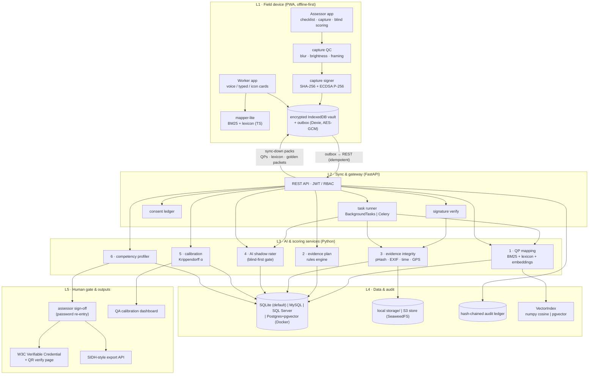

# Architecture

SkillSync Co-Pilot has five layers. The field device is offline-first. All AI services sit behind interfaces, so a better model can be swapped in without touching the workflow.

## Key flows

1. **Declaration (M1/M2).** The worker gives consent, then tells their "kaam ki kahani". Mapper-lite produces a provisional QP on the device. Once online, the server's hybrid mapper replaces it. The worker confirms, and that creates an assessment request.
2. **Evidence plan (M3).** The rules engine (Python, mirrored in TS) assigns a route to every PC. Critical and safety PCs are always `observe`.
3. **Capture (M4).** The assessor captures Process, Product and Person shots. The Person shot shows the one-time challenge code. Each packet is QC-checked, hashed, ECDSA-signed and stored in the encrypted vault, then sent through the outbox. The server verifies the signature and hash, then checks pHash reuse and EXIF/time/GPS plausibility.
4. **Blind-first scoring (M5).** The assessor scores a PC, and only then does `GET /assessments/{id}/ai-suggestions` return the suggestion for that PC. A gap at or above the threshold requires a reason code.
5. **Profile and sign-off (M6).** PC scores roll up into NOS scores using the QP's theory/practical/viva weights and the 70% rule, giving a Full / Partial / Gap recommendation. The assessor signs off by re-entering their password. Only then is an Ed25519-signed VC issued, with a PDF and a QR code.
6. **Calibration.** Golden packets sit in assessor queues without being marked. Krippendorff's α and the Calibration Index are computed from them, and QA sees drift heat-maps.

## Database strategy

The data layer is database-agnostic through SQLModel/SQLAlchemy and Alembic, and `DATABASE_URL` picks the backend. Models use only portable types: SQLAlchemy `JSON`, `String(n)` for indexed text, and no ARRAY/JSONB. Embeddings are stored as JSON and loaded into an in-memory numpy matrix behind a `VectorIndex` interface. pgvector is used only in Docker full mode.
