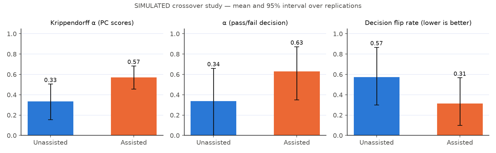
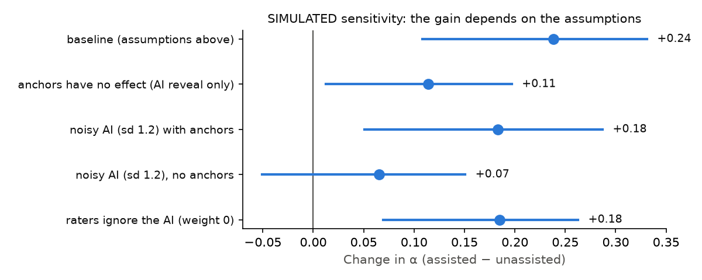

# Consistency study — SIMULATED

> **This is a simulation, not evidence.** The improvement it shows comes from the assumed effect sizes listed below. Its purpose is to exercise the measurement (Krippendorff's α, decision agreement) and to show how the conclusion depends on the assumptions. Real evidence must come from the **live study mode** in the app, with real assessors scoring the same packets with assistance OFF and then ON.

Generated by `python scripts/simulate_study.py --reps 200 --seed 26242`.

## Design

- Crossover AB/BA: 30 packets × 14 photo-judged PCs (Welding QP), 8 raters in two groups. Each rater scores every packet once: half unassisted, half assisted. The packet halves are swapped between groups, and a small practice effect is applied to the second half in both arms.
- Unassisted: each rater has a personal bias (leniency or severity) and noise.
- Assisted: the rubric anchors reduce bias and noise. After the blind score the AI suggestion is revealed and the rater moves part of the way towards it when the gap is ≥ 1.
- 200 Monte-Carlo replications. Values are means with 95% intervals.

## Assumptions

| Parameter | Value |
|---|---|
| `packets` | 30 |
| `pcs` | 14 |
| `raters` | 8 |
| `rater_bias_sd` | 0.6 |
| `rater_noise_lo` | 0.5 |
| `rater_noise_hi` | 1.0 |
| `anchor_bias` | 0.6 |
| `anchor_noise` | 0.7 |
| `ai_sd` | 0.5 |
| `adjust_weight` | 0.4 |
| `period_effect` | 0.1 |
| `seconds_per_pc` | 20.0 |
| `reveal_seconds` | 6.0 |
| `reason_seconds` | 15.0 |

## Results (baseline assumptions)

| Metric | Unassisted | Assisted |
|---|---|---|
| Krippendorff α, PC scores (ordinal) | 0.33 (0.16–0.51) | 0.57 (0.45–0.68) |
| Mean per-PC α | 0.33 (0.15–0.50) | 0.57 (0.45–0.68) |
| α, pass/fail decision (nominal) | 0.34 (-0.01–0.66) | 0.63 (0.35–0.87) |
| Packets where raters disagree on pass/fail (flip rate) | 57% (30%–87%) | 31% (10%–57%) |
| Decisions matching the simulated truth | 77% (62%–88%) | 88% (77%–97%) |
| Mean absolute error vs truth (levels) | 0.61 (0.50–0.75) | 0.39 (0.33–0.46) |
| Time proxy, seconds per packet | 280 (280–280) | 375 (371–381) |

Share of assisted PC scores changed after the AI reveal: 5%.
Change in α: **+0.24** (95% interval +0.11 to +0.33); assisted was higher in 100% of replications.

## Sensitivity — when assistance would NOT help

| Scenario | Change in α (mean, 95% interval) | Assisted better in |
|---|---|---|
| baseline (assumptions above) | +0.24 (+0.11 to +0.33) | 100% |
| anchors have no effect (AI reveal only) | +0.11 (+0.01 to +0.20) | 98% |
| noisy AI (sd 1.2) with anchors | +0.18 (+0.05 to +0.29) | 99% |
| noisy AI (sd 1.2), no anchors | +0.07 (-0.05 to +0.15) | 91% |
| raters ignore the AI (weight 0) | +0.18 (+0.07 to +0.26) | 99% |

## Honest reading

- Where the gain comes from (in these assumptions): with raters ignoring the AI the gain is +0.18, and with no anchor effect it is +0.11. The AI reveal changed only 5% of scores. Most of the modelled improvement comes from the shared rubric anchors, not from the AI.
- With the baseline assumptions, assistance raises agreement and cuts pass/fail flips. The size of the effect is set by `anchor_*`, `ai_sd` and `adjust_weight`, all of which are assumptions.
- Agreement is not accuracy. A noisy AI that raters follow can make them agree with each other *and* with the AI's errors. The noisy-AI rows show where the gain shrinks or reverses, which is why the UI shows the AI only after the blind score, keeps the blind score in the ledger, and asks for a reason on large gaps.
- Assistance costs time (reading the reveal, reason codes) in this proxy. Real timing must be measured.
- Next step: run the in-app live study (QA → Studies) with real assessors, OFF then ON, on the same packets.
